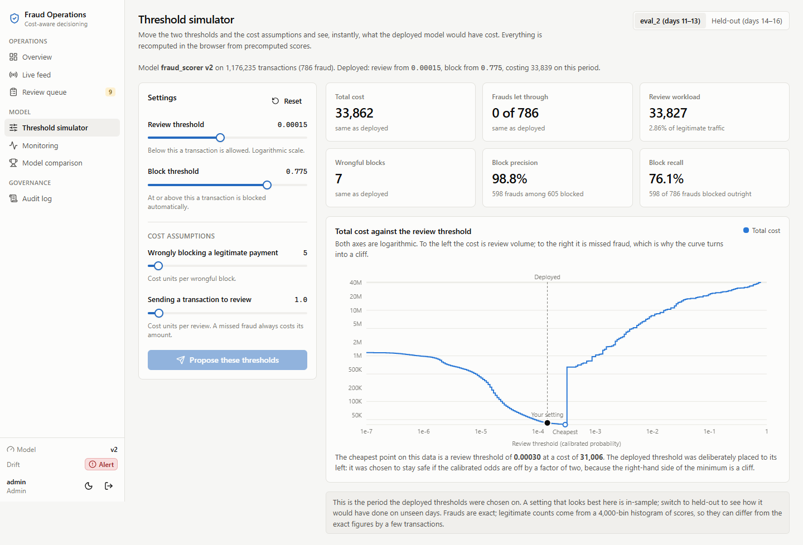
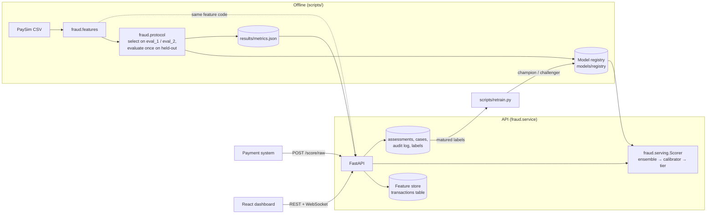
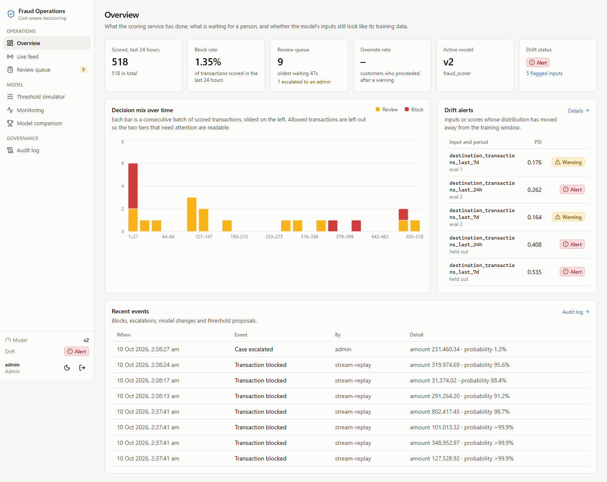
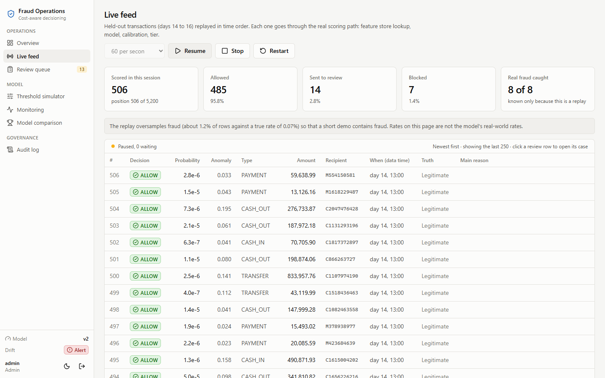
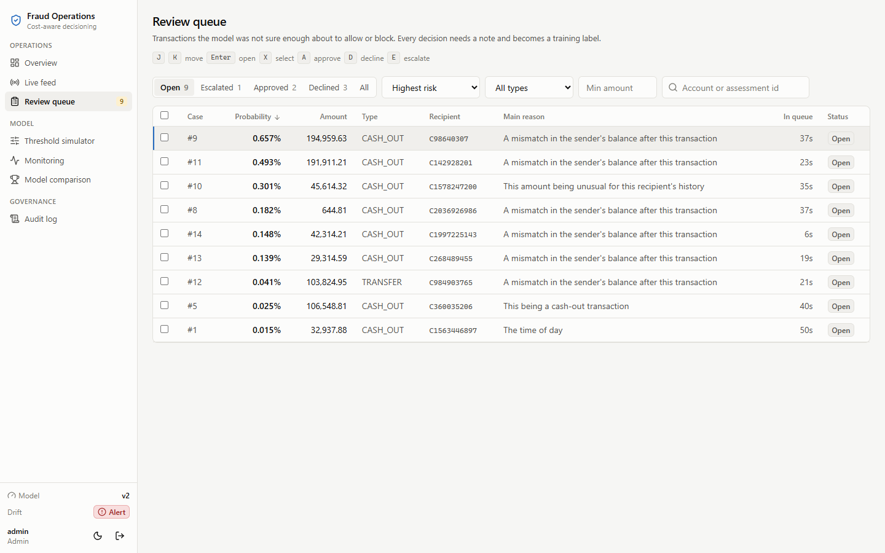
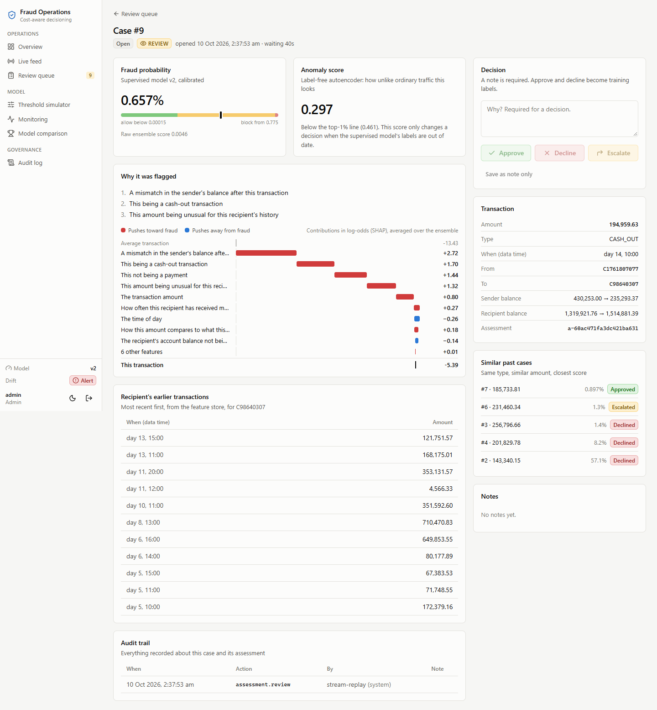
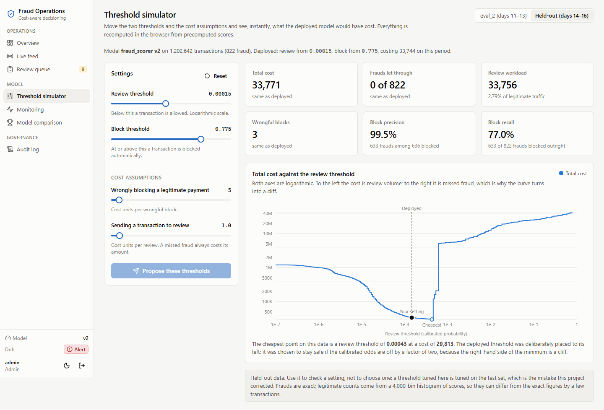
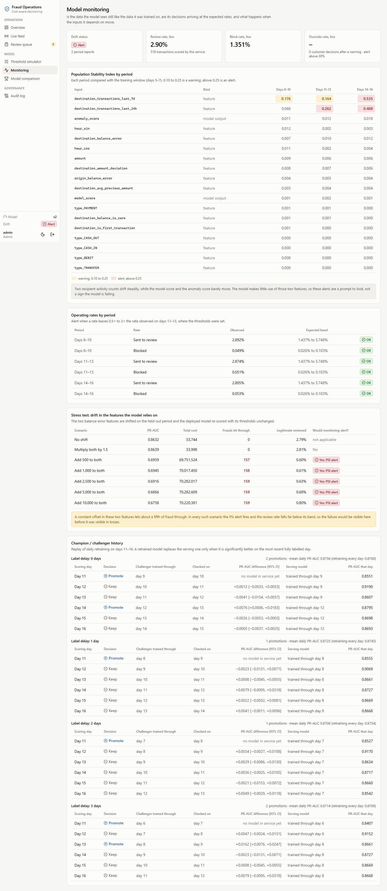
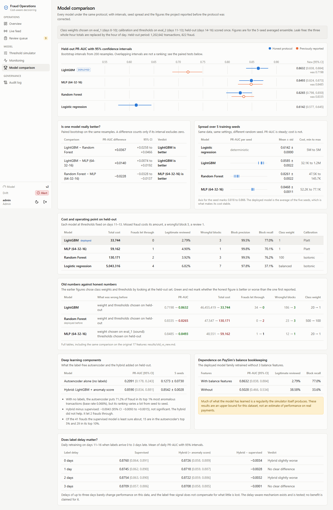
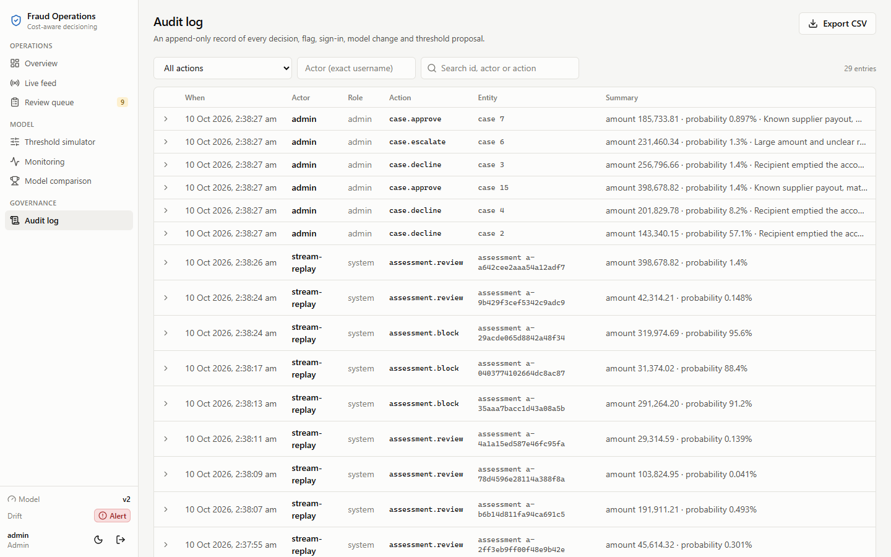

# Cost-Aware Fraud Detection with Delay-Aware Decisioning

A fraud detection system built on the [PaySim](https://www.kaggle.com/datasets/ealaxi/paysim1) mobile-money dataset (6.36 million transactions, 8,213 fraud), taken past "the model got a good score" to the questions a fraud team would ask before trusting it:

- Were the numbers earned honestly, or tuned on the test set?
- Does the live service score a transaction the same way the evaluation did?
- A false alarm and a missed fraud do not cost the same. What should the system *do* with a score?
- What happens when fraud labels arrive late, or when the data drifts?
- Can an analyst see why a transaction was flagged, and act on it?

The repository contains the modelling code, a scoring and operations API, a nine-page operations dashboard, and a record of what was wrong with the first version and how it was corrected.



## What it does

Every transaction gets a calibrated fraud probability and lands in one of three tiers:

| Tier | When | What happens |
|---|---|---|
| **ALLOW** | probability below 0.000146 | Goes through |
| **REVIEW** | 0.000146 to 0.775 | Opens a case for an analyst |
| **BLOCK** | 0.775 and above | Stopped automatically |

The thresholds come from a cost model with three stated assumptions: a missed fraud costs its amount, wrongly blocking a legitimate payment costs 5 units, and sending a transaction to review costs 1. Those numbers are illustrative, not real business figures, and the dashboard's simulator lets you change them.

The review threshold looks tiny because it is a calibrated probability at a fraud rate of 0.07%, and missing a fraud is far more expensive than a review.

## Results

All figures are for the held-out period, days 14 to 16: 1,202,642 transactions, 822 fraud. Models were trained on days 5 to 7. Class weights were chosen on days 8 to 10, calibration and thresholds on days 11 to 13, and the held-out period was scored once. Each model is the average of five training seeds. Intervals are 95%, from 200 bootstrap resamples.

| Model | PR-AUC [95% CI] | 5 seeds | Total cost | Fraud let through | Legitimate reviewed | Wrongful blocks |
|---|---|---|---|---|---|---|
| **LightGBM ensemble (deployed)** | 0.8632 [0.8384, 0.8835] | 0.8585 ± 0.0022 | 33,744 | 0 | 2.79% | 3 |
| MLP (64-32-16) | 0.8493 [0.8242, 0.8734] | 0.8468 ± 0.0011 | 59,162 | 1 | 4.90% | 1 |
| Random Forest | 0.8265 [0.7979, 0.8503] | 0.8261 ± 0.0022 | 130,171 | 2 | 3.92% | 3 |
| Logistic regression | 0.6142 [0.5772, 0.6453] | 0.6142 ± 0.0000 | 5,043,316 | 4 | 6.82% | 7 |

- **LightGBM is the best ranker, and the difference is significant** by paired bootstrap: +0.0367 PR-AUC over the Random Forest (CI +0.0258 to +0.0466) and +0.0140 over the MLP (CI +0.0074 to +0.0192).
- **The deployed model is an ensemble for a reason.** A single LightGBM is steady in PR-AUC but not in cost: across the five seeds it ranges from 32,112 to 1,202,032, because the review threshold sits next to a cliff. Averaging the five removes that.
- **The block tier is precise:** 99.5% precision at 77.0% recall. The remaining frauds go to a person instead of through.

Full tables, seed spreads, threshold robustness and paired tests are in [results/old_vs_new.md](results/old_vs_new.md). Every number in this README is in [results/metrics.json](results/metrics.json) with the script that produced it.

### What changed from the first version

The first version of this project reported a Random Forest at PR-AUC 0.8335 with "0 of 822 frauds missed" at a cost of 47,547. Those figures were not honest: the class weights and the thresholds had been chosen by looking at the held-out set.

| | First version | Corrected |
|---|---|---|
| Deployed model | Random Forest | LightGBM 5-seed ensemble |
| LightGBM PR-AUC | 0.7198 (class weight 20, never tuned properly) | 0.8632 (class weight 1, chosen on validation) |
| Random Forest PR-AUC | 0.8335 | 0.8265 |
| Random Forest, frauds let through | 0 | 2 |
| Random Forest cost | 47,547 | 130,171 |
| Deployed model cost | 47,547 | 33,744 |

The corrected deployed model is better than the first one, but the route there mattered: the old ranking of models was wrong, and the model that looked best was only best because it had been tuned on the test.

## Limitations

Read these before quoting any number above.

- **The model leans on a property of the simulator.** Three features compare an account's balance before and after a transaction. Without them PR-AUC falls from 0.8632 to 0.5028 and 38.58% of legitimate traffic would need review. In PaySim that relationship comes from the simulator's own bookkeeping. These results are an upper bound for this dataset, not an estimate for real payments. See [results/phase3/summary.md](results/phase3/summary.md).
- **"Delay-aware" is a mechanism, not a measured benefit.** The system retrains only on matured labels, gates each new model behind a champion/challenger test, and falls back on a label-free anomaly score when the model is stale. On this data, label delays of one or two days had no measurable effect and three days cost 0.005 PR-AUC, so no performance benefit is claimed. See [results/phase5/summary.md](results/phase5/summary.md).
- **The autoencoder is unstable and the hybrid did not help.** With no labels, the autoencoder puts 71.2% of fraud in its top 1% most anomalous transactions, but its PR-AUC ranges from 0.061 to 0.223 across five seeds. Adding its score to the supervised model changed PR-AUC by −0.0043 (not significant). See [results/phase4/summary.md](results/phase4/summary.md).
- **The model is fragile to drift in the features it relies on.** Adding a constant to the two balance-error features lets about 158 of 822 frauds through. The monitoring raises an alert in that case; it does not prevent it. See [results/monitoring/summary.md](results/monitoring/summary.md).
- **The review threshold is still next to a cliff.** It was placed to be safe if calibrated odds are off by a factor of two, but a large enough move to the right is very expensive. The simulator shows this directly.
- **The cost values are illustrative**, not real business costs.
- **Docker is untested.** `docker-compose.yml` and both Dockerfiles are written but have never been built: the development machine had no disk space for the images. Treat them as unverified. The PostgreSQL path is likewise unverified; everything was run on SQLite.
- **Not production-grade throughput.** One worker on SQLite scores a transaction in 81.7 ms at the median (174.9 ms at the 95th percentile) and manages about 9 requests per second under load.
- **The live demo oversamples fraud** (1.21% of replayed rows against a true rate of 0.068%) so that a short demo contains fraud. Rates on the live-feed page are not the model's real rates.
- **PaySim is synthetic.** Its fraud follows simulator rules and does not change over time, which is probably why label delay shows no effect.

## Architecture



The point of the layout is that there is one definition of every feature and one scoring path. The evaluation scripts and the API both call `fraud.features` and `fraud.serving.Scorer`, and `tests/test_parity.py` replays 1,000 held-out transactions through the live API and checks the probabilities match the offline ones to 1e-6. The first version of this project had the API sending 14 features to a 17-feature model and returning a confident 0% for obvious fraud; this test is what would have caught it.

## Running it

You need Python 3.12 and Node.js 20 or later. The trained model, the demo data and all result files are in the repository, so nothing needs to be downloaded or retrained to run the system.

```bash
git clone https://github.com/anushka-saini/Cost-Aware-Fraud-Detection-with-Delay-Aware-Decisioning.git
cd Cost-Aware-Fraud-Detection-with-Delay-Aware-Decisioning

python -m venv fraud_env
fraud_env\Scripts\activate          # macOS / Linux: source fraud_env/bin/activate
pip install torch==2.14.1 --index-url https://download.pytorch.org/whl/cpu
pip install -e ".[dev]"
```

**1. Start the API** (from the project root):

```bash
uvicorn fraud.service.app:app --port 8000
```

On first start it creates a SQLite database at `api/fraud.db`, two demo accounts, and loads the demo recipients' history into the feature store. Interactive API docs are at http://127.0.0.1:8000/docs.

**2. Start the dashboard** (second terminal):

```bash
cd dashboard
npm install
npm run dev
```

Open http://localhost:5173 and sign in:

| Account | Username | Password | Sees |
|---|---|---|---|
| Analyst | `analyst` | `analyst123` | Overview, live feed, review queue, simulator, audit log |
| Admin | `admin` | `admin123` | All of that, plus monitoring, model comparison and threshold proposals |

Go to **Live feed** and press **Start**. Transactions sent to review appear in the **Review queue**.

**With Docker** (unverified, see Limitations): `docker compose up --build`, then open http://localhost:5173.

**Streamlit backup demo:** `streamlit run app.py` with the API running. It is a single scoring form, kept as a fallback.

### Tests

```bash
pytest                    # 64 tests; those needing the PaySim data skip themselves if it is absent
ruff check src scripts tests
python scripts/smoke_test.py      # starts a real server and walks the demo path
```

Coverage is 77% of `src/` overall and above 90% on the service modules; the rest is training code that only the scripts exercise.

## The dashboard

| Page | What it is for |
|---|---|
|  **Overview** | Volumes, block and review rates, queue size, active model, drift status |
|  **Live feed** | Held-out transactions replayed through the real scoring path over a WebSocket |
|  **Review queue** | The analyst's main screen: sort, filter, bulk actions, keyboard shortcuts |
|  **Case detail** | Both scores, a SHAP waterfall, plain-English reasons, the recipient's history, similar cases, mandatory notes, audit trail |
|  **Threshold simulator** | Move the thresholds and the cost assumptions and see cost, missed fraud and workload recomputed instantly, with the cost curve showing the cliff |
|  **Monitoring** | PSI by feature and period, operating-rate bands, the drift stress test, champion/challenger history |
|  **Model comparison** | Every model with intervals and seed spread, and the old numbers against the corrected ones |
|  **Audit log** | Every decision, flag, sign-in, model change and threshold proposal; searchable, exportable |

Light and dark mode are both supported ([dark example](docs/screenshots/10-dark-threshold-simulator.png)). An admin can *propose* thresholds from the simulator; a proposal is written to the audit log and never changes production.

## The API

Scoring endpoints are open, as a payment system would call them. Everything else needs a token from `POST /auth/login`.

| Endpoint | What it does |
|---|---|
| `POST /score/raw` | Scores a raw transaction. The service computes the recipient-history features itself from stored transactions. |
| `POST /score` | Scores pre-computed features (the original request format, still accepted) |
| `POST /explain` | SHAP contribution of every input for one transaction |
| `POST /confirm-decision` | Records the customer's proceed / cancel choice after a warning |
| `GET /cases`, `GET /cases/{id}` | Review queue and case detail |
| `POST /cases/{id}/decision` | Approve, decline or escalate, with a mandatory note. The verdict becomes a training label. |
| `WS /stream` | Replays held-out transactions as a live feed at a chosen speed |
| `GET /simulator/scores` | Precomputed scores for the threshold simulator |
| `POST /thresholds/proposals` | Admin only. Records a proposal in the audit log. |
| `GET /monitoring/drift`, `GET /overview` | Drift reports and KPIs |
| `GET /models`, `POST /models/rollback` | Registered model versions; switch the serving version (admin) |
| `GET /audit`, `GET /audit/export.csv` | Audit log |
| `POST /labels`, `GET /labels` | Outcomes learned after scoring, with their maturity |
| `GET /model-info`, `GET /health` | The loaded model bundle; health check |

```bash
curl -X POST http://127.0.0.1:8000/score/raw -H "Content-Type: application/json" -d "{\"step\": 340, \"type\": \"TRANSFER\", \"amount\": 250000, \"nameOrig\": \"C1\", \"nameDest\": \"C2\", \"oldbalanceOrg\": 250000, \"newbalanceOrig\": 0, \"oldbalanceDest\": 0, \"newbalanceDest\": 0}"
```

## Reproducing the results

The PaySim data is too large for the repository. Download it from Kaggle to `data/raw/transaction_data.csv`. The scripts build the features from that file when no cached feature table exists (slower on every run; `notebooks/01_data_audit.ipynb` writes the cache to `data/processed/paysim_features.parquet`). Then:

```bash
python scripts/verify_features.py                                    # features rebuilt from raw match the cache
python scripts/run_protocol.py --tag phase2 --features v2 --stage select   # weights on eval_1, thresholds on eval_2
python scripts/run_protocol.py --tag phase2 --features v2 --stage final    # the single held-out evaluation
python scripts/run_protocol.py --tag phase3 --features v2_no_balance --stage select --families lightgbm
python scripts/run_protocol.py --tag phase3 --features v2_no_balance --stage final  --families lightgbm
python scripts/phase4_autoencoder.py --stage select && python scripts/phase4_autoencoder.py --stage final
python scripts/phase5_rolling.py
python scripts/register_model.py --tag phase2 --family lightgbm --autoencoder-tag phase4
python scripts/run_monitoring.py
python scripts/render_old_vs_new.py --tags phase2 phase1
```

The `final` stage refuses to run twice for the same tag, so the held-out set cannot be reused by accident. Expect several hours on a laptop.

## What's in the repo

```
├── src/fraud/                 Shared package
│   ├── features.py            Feature engineering: one batch path, one online path, same formulas
│   ├── protocol.py            The evaluation protocol (select on eval_1 / eval_2, evaluate once)
│   ├── evaluation.py          PR-AUC, bootstrap, paired tests, cost model, threshold sweeps
│   ├── models.py, autoencoder.py, calibration.py
│   ├── serving.py             Scorer: features → ensemble → calibrator → tier → explanation
│   ├── monitoring.py, labels.py, registry.py, reporting.py
│   └── service/               FastAPI app: routes, database, auth, live feed
├── scripts/                   Every experiment and result is produced by a script here
├── tests/                     64 tests, including train/serve parity
├── dashboard/                 React + TypeScript + Tailwind operations dashboard
├── results/                   metrics.json, old_vs_new.md and a summary per experiment
├── models/registry/           The registered model bundles the service loads
├── migrations/                Alembic database migrations
├── notebooks/                 The original analysis (01–07), kept as a record
├── docs/                      Screenshots and the demo script
└── app.py                     Streamlit backup demo
```

Notebooks 03, 05 and 07 carry a banner saying which of their figures are superseded. They are kept because they are the record of how the original bugs were found.

## Built with

Python, pandas, scikit-learn, LightGBM, PyTorch, SHAP, FastAPI, SQLAlchemy, Alembic, React, TypeScript, Vite, Tailwind CSS, TanStack Query and Table, Radix UI, Recharts.

## Data credits

- PaySim: Lopez-Rojas, Elmir and Axelsson, *PaySim: A financial mobile money simulator for fraud detection* (2016).
- Credit card fraud dataset (used in notebook 06): Machine Learning Group, Université Libre de Bruxelles.
