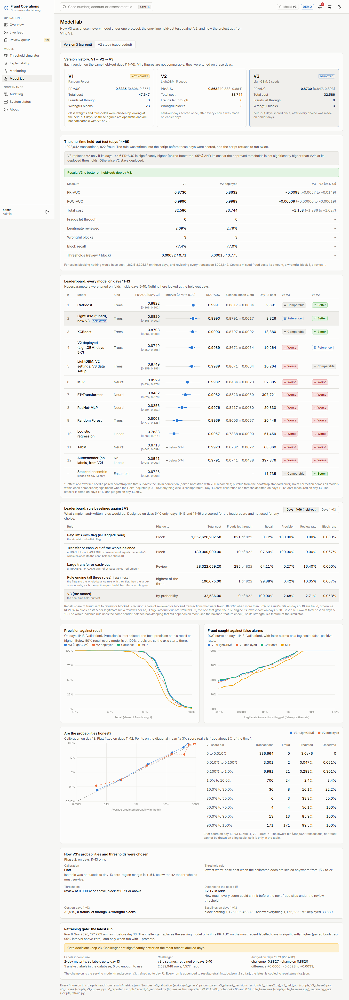
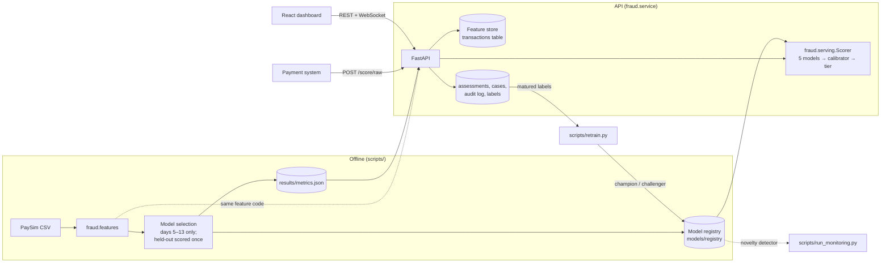

# Cost-Aware Fraud Detection with Delay-Aware Decisioning

A fraud detection system built on the [PaySim](https://www.kaggle.com/datasets/ealaxi/paysim1) mobile-money dataset (6.36 million transactions, 8,213 fraud). It goes past "the model got a good score" to the questions a fraud team would ask before trusting it:

- Were the numbers earned honestly, or tuned on the test set?
- Does the live service score a transaction the same way the evaluation did?
- A false alarm and a missed fraud do not cost the same. What should the system *do* with a score?
- What happens when fraud labels arrive late, or when the data drifts?
- Can an analyst see why a transaction was flagged, and act on it?

The repository has the modelling code, a scoring and operations API, an operations dashboard, and a record of three versions: what was wrong with the first one and how each later one was tested.

**Live demo:** not deployed yet. [docs/DEPLOY.md](docs/DEPLOY.md) has the steps.



## What it does

Every transaction gets a calibrated fraud probability and lands in one of three tiers:

| Tier | When | What happens |
|---|---|---|
| **ALLOW** | probability below 0.000316 | Goes through |
| **REVIEW** | 0.000316 up to 0.71 | Opens a case for an analyst |
| **BLOCK** | 0.71 and above | Stopped automatically |

The thresholds come from a cost model with three stated assumptions: a missed fraud costs its amount, wrongly blocking a legitimate payment costs 5, and sending a transaction to review costs 1. These are illustrative values, not real business costs, and the dashboard's simulator lets you change them.

The review threshold looks tiny because fraud is rare (0.07% of transactions) and missing one costs far more than a review. It is exactly 10^-3.5.

## Results: V1 → V2 → V3

All three versions on the same held-out period, days 14 to 16: 1,202,642 transactions, 822 fraud. Intervals are 95%, from 200 bootstrap resamples.

| Version | Model | PR-AUC [95% CI] | Total cost | Fraud let through | Legitimate reviewed | Wrongful blocks |
|---|---|---|---|---|---|---|
| V1 (not honest) | Random Forest | 0.8335 [0.8085, 0.8546] | 47,547 | 0 | 3.93% | 23 |
| V2 | LightGBM, 5 seeds | 0.8632 [0.8384, 0.8835] | 33,744 | 0 | 2.79% | 3 |
| **V3 (deployed)** | **Tuned LightGBM, 5 seeds** | **0.8730 [0.8474, 0.8927]** | **32,586** | **0** | **2.69%** | **3** |

- **V1's numbers were too good.** Its class weights and thresholds were chosen by looking at the held-out days. They are kept for the record, not for comparison.
- **V2 redid everything properly:** models trained on days 5–7, settings chosen on days 8–10, calibration and thresholds on days 11–13, and the held-out days scored once.
- **V3 beat V2 on the held-out test.** PR-AUC +0.0098 (95% CI +0.0057 to +0.0149) and cost −1,158 (95% CI −1,286.1 to −1,026.9), both from paired bootstrap tests. The rule for replacing V2 was written into the script before the held-out days were scored: V3 had to be significantly better on PR-AUC and not significantly more expensive. The script refuses to run a second time.
- **For scale:** blocking nothing would have cost 1,362,518,395.67 on these days, and reviewing every transaction 1,202,642.

### Against hand-written rules

A fraud team without a model would start with rules, so V3 is also compared with four simple ones. They were designed on days 5–10 only; days 11–13 and 14–16 are only scored.

| Days 14–16 | Total cost | Fraud let through | Recall | Review rate | Block rate |
|---|---|---|---|---|---|
| PaySim's own flag (`isFlaggedFraud`) | 1,357,626,202.58 | 821 | 0.12% | 0.00% | 0.000% |
| Transfer or cash-out of the whole balance (blocks) | 180,000,000.00 | 19 | 97.69% | 0.00% | 0.067% |
| Transfer or cash-out of 228,093.63 or more (reviews) | 28,322,059.20 | 295 | 64.11% | 16.40% | 0.000% |
| Rule engine: all three (best rule on days 5–10) | 196,675.00 | 1 | 99.88% | 16.35% | 0.067% |
| **V3** | **32,586.00** | **0** | **100.00%** | **2.71%** | **0.053%** |

The whole-balance rule is strong for the same reason the model is: it reads the simulator's balance bookkeeping. Of the 19 frauds it misses, 18 are transfers of exactly 10,000,000 from a larger balance and one has an amount of 0. Against the best rule, V3 saves 164,089 on these days; against reviewing everything, 1,170,056. Source: `rule_baselines` (`scripts/rule_baselines.py`).

Every number in this README is in [results/metrics.json](results/metrics.json), next to the name of the script that produced it.

### How V3 was chosen (days 5–13 only)

Nothing below looked at the held-out days.

**1. One change at a time to V2.** More training days, weighting by amount, and new recipient features were each tried on days 11–13. None helped significantly, so V3 kept V2's data setup.

**2. A leaderboard.** Each model was tuned with Optuna on folds inside days 5–10, trained with 5 seeds, and compared on days 11–13. "Better" and "worse" need a paired bootstrap win that survives a Holm correction for the number of models; anything else is "comparable".

| Model | PR-AUC on days 11–13 [95% CI] | Day-13 cost | vs tuned LightGBM | vs V2 |
|---|---|---|---|---|
| CatBoost | 0.8822 [0.8664, 0.9018] | 9,691 | comparable | better |
| **LightGBM, tuned (V3)** | **0.8820 [0.8663, 0.9019]** | **9,826** | reference | better |
| XGBoost | 0.8798 [0.8644, 0.9004] | 18,380 | comparable | better |
| V2 as deployed | 0.8749 [0.8588, 0.8945] | 10,264 | worse | reference |
| Stacked ensemble (judged on day 13 only) | 0.8728 [0.8339, 0.9076] | 11,735 | comparable | better |
| MLP | 0.8529 [0.8341, 0.8764] | 32,805 | worse | worse |
| FT-Transformer | 0.8432 [0.8239, 0.8701] | 397,721 | worse | worse |
| ResNet-MLP | 0.8256 [0.8037, 0.8514] | 20,330 | worse | worse |
| Random Forest | 0.8008 [0.7771, 0.8281] | 20,448 | worse | worse |
| Logistic regression | 0.7838 [0.7598, 0.8113] | 51,459 | worse | worse |
| TabM | 0.6713 [0.6418, 0.6990] | 68,860 | worse | worse |
| Autoencoder (no labels) | 0.0541 [0.0462, 0.0628] | 397,876 | worse | worse |

Day-13 cost is an extra out-of-sample check: calibration and thresholds fitted on days 11–12, cost measured on day 13. CatBoost and XGBoost were not significantly better than LightGBM, so the simpler, already-deployed model family stayed.

**3. Calibration and thresholds** were chosen on days 11–13. Platt scaling was used. Isotonic calibration was rejected by a rule written down first: its safety margin on day 13 was only ×1.54, short of the ×2 required. The thresholds are the ones with the lowest worst-case cost if the probabilities are off by up to a factor of two either way. Every score could shrink by ×2.17 (in odds) before the next fraud would slip under the review threshold.

The dashboard's **Model lab** page shows all of this with intervals, PR and ROC curves, and a calibration plot.

## Limitations

Read these before quoting any number above. The [model card](docs/MODEL_CARD.md) puts the intended use, the data, the metrics with their intervals and the failure modes on one page.

- **The model leans on a property of the simulator.** The strongest inputs compare an account's balance before and after a transaction. In the V2 study, removing them dropped PR-AUC from 0.8632 to 0.5028, and 38.58% of legitimate traffic would have needed review. In PaySim that relationship comes from the simulator's own bookkeeping. These results are an upper bound for this dataset, not an estimate for real payments. See [results/phase3/summary.md](results/phase3/summary.md).
- **The held-out days are not brand new.** V1 was tuned on them and V2 was scored on them. V3 made every choice on earlier days and scored them once, but they had been seen before.
- **Few frauds.** 822 frauds in the held-out period means wide intervals; small differences mean little.
- **"Delay-aware" is a mechanism, not a measured benefit.** The system retrains only on matured labels and puts each new model through a champion/challenger test. In the V2 study, label delays of up to three days made almost no difference on this data, so no benefit is claimed. See [results/phase5/summary.md](results/phase5/summary.md). The job works with V3: run as of day 16, it retrained V3's settings on days 5–10 and the gate kept V3 (PR-AUC on days 11–13: 0.8827 against 0.8820, difference +0.0006, 95% CI −0.0023 to +0.0039). Source: `retraining_gate` (`scripts/retrain.py`).
- **The autoencoder is a monitor, not a detector.** Used as a fraud score it reaches a PR-AUC of only 0.0541 on days 11–13. Since V3 it only feeds monitoring, where it tracks the share of unusual transactions.
- **The model is fragile to drift in the features it relies on.** Adding 500 or more to the two balance-error features lets 113 of the 822 held-out frauds through. Monitoring raises an alert in that case; it does not prevent it. See [results/monitoring/summary.md](results/monitoring/summary.md).
- **The review threshold is near a cost cliff.** It survives the probabilities being off by ×2.17, but a bigger shift is very expensive. The simulator shows this directly.
- **The cost values are illustrative**, not real business costs.
- **Docker is not yet verified end to end.** `docker-compose.yml`, the Dockerfiles and a CI job that starts the whole stack on PostgreSQL are written, but Docker does not start on this laptop. The API itself has been run on PostgreSQL 17 with 1, 2 and 4 worker processes (the speed test below), using the same start-up steps as the container.
- **Speed was measured on one laptop.** See [Speed](#speed). Each setup was run once, with the test client on the same machine, so the numbers move a lot from run to run.
- **The live demo oversamples fraud** so that a short demo contains some. Rates on the live-feed page are not the model's real rates.

## Speed

`POST /score/raw` with V3, measured by `scripts/benchmark_api.py` on the development laptop (12 logical cores, plugged in). Every request does the whole job: recipient-history lookup, the 16 inputs, five models, calibration, the tier, SHAP reasons when flagged, and the database writes. Each setup starts from a fresh database.

| Setup | Median, one request at a time | 95th percentile | 8 clients at once: median | Requests per second (8 clients) |
|---|---|---|---|---|
| 1 worker, SQLite | 20.2 ms | 35.3 ms | 88.0 ms | 79.3 |
| 1 worker, PostgreSQL | 24.5 ms | 45.0 ms | 142.9 ms | 50.8 |
| 2 workers, PostgreSQL | 15.0 ms | 25.4 ms | 81.8 ms | 79.6 |
| 4 workers, PostgreSQL | 19.0 ms | 33.6 ms | 104.9 ms | 62.4 |

V3 is several times faster than V2 was (81.7 ms at the median, one worker on SQLite), mostly because it has no autoencoder in the scoring path. More workers did not clearly help here: the test client and the database run on the same laptop and compete for the same cores, and one run per setup is not enough to separate the setups. Source: `v3_latency` (V2: `phase7_latency`).

Measuring this found a bug, now fixed: the first explanation after a start imports SHAP (about 5 seconds), and it used to do that while holding SQLite's write lock, so other requests failed with "database is locked".

## Architecture



There is one definition of every feature and one scoring path. The evaluation scripts and the API both call `fraud.features` and `fraud.serving.Scorer`, and `tests/test_parity.py` replays held-out transactions through the live API and checks the probabilities match the offline ones. The first version of this project had the API sending 14 features to a 17-feature model and returning a confident 0% for obvious fraud; this test is what would have caught it.

The API loads the newest registered model when it starts. With several worker processes, each one follows the version the database marks as active, so a rollback reaches every worker within 10 seconds.

## Running it

**With Docker (one command).** You need Docker Desktop. From the project folder:

```bash
docker compose up --build
```

Then open http://localhost:5173. This starts PostgreSQL, the API with two workers, and the dashboard, in demo mode. [docs/DEPLOY.md](docs/DEPLOY.md) explains it and how to put it online.

**Without Docker.** You need Python 3.12 and Node.js 20 or later. The trained models, the demo data and all result files are in the repository, so nothing needs to be downloaded or retrained.

```bash
git clone https://github.com/anushka-saini/Cost-Aware-Fraud-Detection-with-Delay-Aware-Decisioning.git
cd Cost-Aware-Fraud-Detection-with-Delay-Aware-Decisioning

python -m venv fraud_env
fraud_env\Scripts\activate          # macOS / Linux: source fraud_env/bin/activate
pip install torch==2.14.1 --index-url https://download.pytorch.org/whl/cpu
pip install -e ".[dev]"
```

Start the API (from the project root):

```bash
uvicorn fraud.service.app:app --port 8000
```

On first start it creates a SQLite database at `api/fraud.db`, two demo accounts, and loads the demo recipients' history. Interactive API docs are at http://127.0.0.1:8000/docs.

Start the dashboard (second terminal):

```bash
cd dashboard
npm install
npm run dev
```

Open http://localhost:5173 and sign in:

| Account | Username | Password | Sees |
|---|---|---|---|
| Analyst | `analyst` | `analyst123` | Overview, live feed, review queue, simulator, explainability, audit log, status, about |
| Admin | `admin` | `admin123` | All of that, plus monitoring, the model lab, threshold proposals and model rollback |

Go to **Live feed** and press **Start**. Transactions sent to review appear in the **Review queue**.

**Streamlit backup demo:** `streamlit run app.py` with the API running. It is a single scoring form with the same five demo scenarios as the dashboard, kept as a fallback. Set `FRAUD_API_URL` to point it at a deployed API.

### Tests

```bash
pytest                    # 98 tests; those needing the PaySim data skip themselves if it is absent
ruff check src scripts tests app.py
python scripts/smoke_test.py      # starts a real server and walks the demo path
```

## The dashboard

| Page | What it is for |
|---|---|
| **Overview** | Volumes with trend lines, block and review rates, queue size, drift status, and the cost V3 avoided on the held-out days against the best hand-written rule and against reviewing everything |
| **Live feed** | Held-out transactions replayed through the real scoring path over a WebSocket, under a banner saying fraud is oversampled |
| **Review queue** | The analyst's main screen: sort, filter, bulk actions, keyboard shortcuts |
| **Case detail** | The score, a SHAP waterfall, plain-English reasons, the recipient's history, similar cases, mandatory notes, audit trail |
| **Threshold simulator** | Move the thresholds and the cost assumptions and see cost, missed fraud and workload recomputed instantly |
| **Explainability** | Which inputs matter overall, five real held-out transactions explained step by step (including two the model got wrong or nearly wrong), and where V3 catches fraud by transaction type and amount quartile |
| **Monitoring** | PSI by feature and period, operating-rate bands, the novelty share, the drift stress test, champion/challenger history |
| **Model lab** | V1 → V2 → V3, the held-out test, the leaderboard with intervals, the rule baselines, PR, ROC and calibration curves, and the retraining gate's latest decision. The V2 study is kept under its own tab, marked superseded |
| **Audit log** | Every decision, flag, sign-in, model change and threshold proposal; searchable, exportable |
| **System status** | Model version, database, monitoring and service health |
| **About** | What the project does, how it was tested, its limitations |

The top bar has search (a case number or an account), monitoring alerts, the model version, a light/dark switch and a presentation mode that enlarges everything for a projector. Ctrl+K opens a command palette. An admin can *propose* thresholds from the simulator; a proposal is written to the audit log and never changes production.

Screenshots of every page are in [docs/screenshots](docs/screenshots).

## The API

Scoring endpoints are open, as a payment system would call them. Everything else needs a token from `POST /auth/login`.

| Endpoint | What it does |
|---|---|
| `POST /score/raw` | Scores a raw transaction. The service computes the recipient-history features itself from stored transactions. |
| `POST /score` | Scores pre-computed features (the original request format, still accepted) |
| `POST /explain` | SHAP contribution of every input for one transaction |
| `POST /confirm-decision` | Records the customer's proceed / cancel choice after a warning |
| `GET /cases`, `GET /cases/{id}` | Review queue and case detail |
| `POST /cases/{id}/decision` | Approve, decline or escalate, with a mandatory note. The verdict becomes a training label. |
| `WS /stream` | Replays held-out transactions as a live feed at a chosen speed |
| `GET /simulator/scores` | Precomputed scores for the threshold simulator |
| `POST /thresholds/proposals` | Admin only. Records a proposal in the audit log. |
| `GET /monitoring/drift`, `GET /overview` | Drift reports and KPIs |
| `GET /results/v3`, `GET /explainability` | The Model lab and Explainability data, read from `results/metrics.json` |
| `GET /models`, `POST /models/rollback` | Registered model versions; switch the serving version (admin) |
| `GET /audit`, `GET /audit/export.csv` | Audit log |
| `POST /labels`, `GET /labels` | Outcomes learned after scoring, with their maturity |
| `GET /status`, `GET /health` | Service status (model, database, monitoring); health check |

V3 has no anomaly detector in its scoring path, so `anomaly_score` is `null` in its responses. The field is still sent, so clients see the same response shape for every model version.

```bash
curl -X POST http://127.0.0.1:8000/score/raw -H "Content-Type: application/json" -d "{\"step\": 340, \"type\": \"TRANSFER\", \"amount\": 250000, \"nameOrig\": \"C1\", \"nameDest\": \"C2\", \"oldbalanceOrg\": 250000, \"newbalanceOrig\": 0, \"oldbalanceDest\": 0, \"newbalanceDest\": 0}"
```

## Reproducing the results

The PaySim data is too large for the repository. Download it from Kaggle to `data/raw/transaction_data.csv`. The scripts build the features from that file when no cached feature table exists. The model comparison also needs the research extras (Optuna, XGBoost, CatBoost, TabM). Then, for V3:

```bash
pip install -e ".[dev,research]"
python scripts/verify_features.py               # features rebuilt from raw match the cache
python scripts/v3_phase1.py ladder              # one change at a time to V2 (days 11-13)
python scripts/v3_phase1.py cost-check
python scripts/v3_phase1.py recipient-check
python scripts/v3_phase1.py tune lightgbm catboost xgboost random_forest logreg mlp resnet ft_transformer tabm
python scripts/v3_phase1.py compare             # leaderboard, stacking, paired tests
python scripts/v3_phase2.py                     # calibration and thresholds on days 11-13
python scripts/v3_phase3.py                     # the one-time held-out test (refuses to run twice)
python scripts/register_v3.py                   # only registers V3 if it won the held-out test
python scripts/register_novelty_detector.py
python scripts/run_monitoring.py
python scripts/build_simulator_data.py
python scripts/v3_curves.py                     # curves for the Model lab page
python scripts/v3_explainability.py             # feature importance and the demo scenarios
python scripts/record_v1_reported.py            # V1's original figures, for the history table
python scripts/rule_baselines.py                # hand-written rules, designed on days 5-10
python scripts/v3_breakdown.py                  # held-out result by type and amount (describes, tunes nothing)
python scripts/retrain.py --as-of-day 16 --maturity-days 2    # retraining job and its champion/challenger gate
python scripts/benchmark_api.py                 # speed; add --workers 4 --database-url postgresql://... for several workers
```

The V2 study's scripts (`run_protocol.py`, `phase4_autoencoder.py`, `phase5_rolling.py`) are still in `scripts/` and their results are still in `results/`. Tuning takes most of a day on a laptop.

## What's in the repo

```
├── src/fraud/                 Shared package
│   ├── features.py            Feature engineering: one batch path, one online path, same formulas
│   ├── protocol.py            The evaluation protocol and the threshold rule
│   ├── evaluation.py          PR-AUC, bootstrap, paired tests, Holm correction, cost model
│   ├── tuning.py, nets.py     Optuna search; the neural network models
│   ├── models.py, autoencoder.py, calibration.py
│   ├── serving.py             Scorer: features → models → calibrator → tier → explanation
│   ├── monitoring.py, labels.py, registry.py, reporting.py
│   └── service/               FastAPI app: routes, database, auth, live feed
├── scripts/                   Every experiment and result is produced by a script here
├── tests/                     98 tests, including train/serve parity
├── dashboard/                 React + TypeScript + Tailwind operations dashboard
├── results/                   metrics.json and a summary per experiment (V3 in results/v3/)
├── models/registry/           The registered model bundles the service loads (v2, v3, novelty detector)
├── migrations/                Alembic database migrations
├── notebooks/                 The original analysis (01–07), kept as a record
├── docs/                      Screenshots, the demo script and the deployment guide
└── app.py                     Streamlit backup demo
```

Superseded material is kept and marked: notebooks 03, 05 and 07 carry a banner, V2's monitoring reports are in `results/monitoring/v2_superseded/`, and the V2 study has its own tab in the Model lab.

## How this was built

This project was built by Anushka. An AI coding assistant, Claude Code, was used throughout: to write and review code, run the experiments, and draft the documentation.

Built with Python, pandas, scikit-learn, LightGBM, CatBoost, XGBoost, PyTorch, Optuna, SHAP, FastAPI, SQLAlchemy, Alembic, React, TypeScript, Vite, Tailwind CSS, TanStack Query and Table, Radix UI and Recharts.

## Data credits

- PaySim: Lopez-Rojas, Elmir and Axelsson, *PaySim: A financial mobile money simulator for fraud detection* (2016).
- Credit card fraud dataset (used in notebook 06): Machine Learning Group, Université Libre de Bruxelles.
